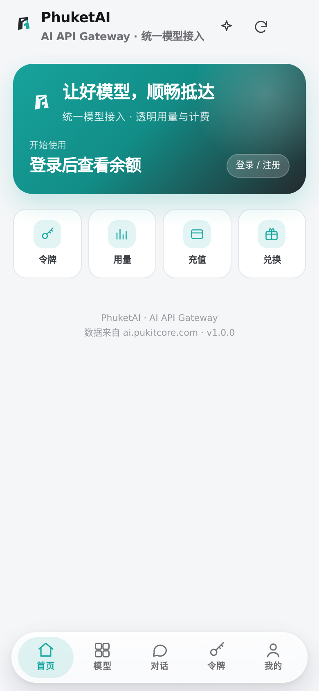
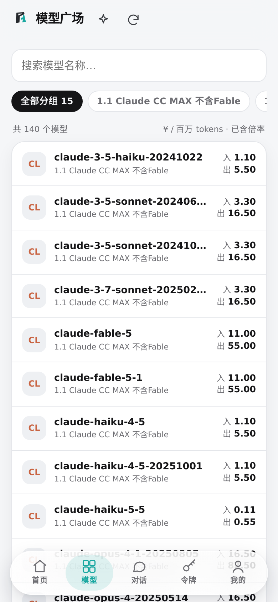
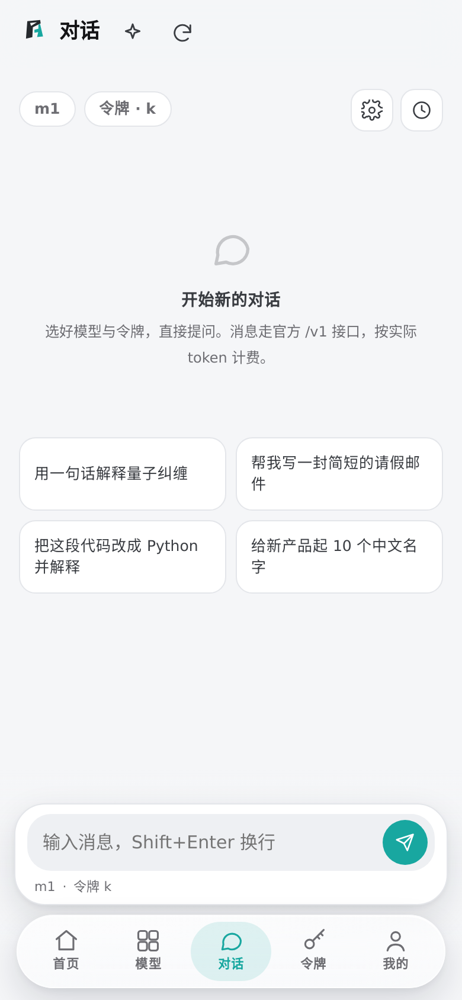
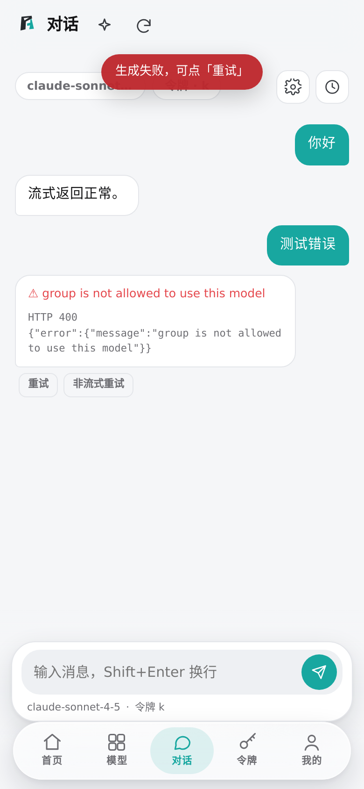
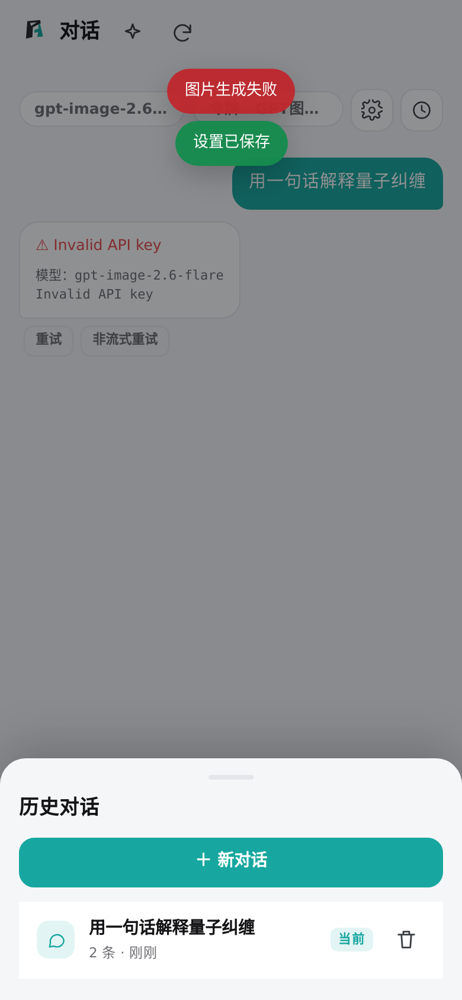
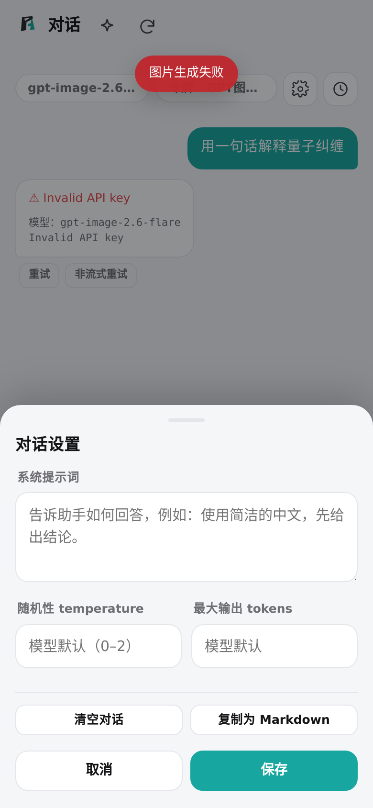

# PhuketAI Android 客户端（复刻 ai.pukitcore.com）

原生 Android 外壳（Java + WebView）+ 内置单页应用，直接调用 `ai.pukitcore.com` 的真实接口。
不是套壳浏览器：所有网络请求经由原生 `HttpURLConnection` 桥接（规避 WebView 跨域限制），
登录态、令牌、SSE 流式对话、用量统计都在 App 内完成。

- 包名：`com.phuketai.app` · 版本：1.0.3 · minSdk 23 / targetSdk 34
- 产物：`PhuketAI.apk`（约 70 KB，v1+v2+v3 签名）
- 接口基址：`https://ai.pukitcore.com/api/v1`（JSON API）、`https://ai.pukitcore.com/v1`（OpenAI 兼容）

## 已实现功能

| 模块 | 说明 | 真实接口 |
| --- | --- | --- |
| 首页 | 余额、今日消耗/请求、公告、分组倍率、模型速览 | `/settings/public`、`/announcements/public`、`/model-plaza`、`/usage/stats` |
| 模型广场 | 15 个分组 / 140+ 模型，搜索、分组筛选、价格（已含倍率）、详情、跳转对话 | `/model-plaza` |
| 对话 | 多会话历史、系统提示词/随机性/最大输出、SSE 流式、Markdown、停止、重新生成、复制为 Markdown | `/v1/models`、`/v1/chat/completions` |
| 令牌 | 列表、额度进度、状态、新建/编辑/停用/删除、Base URL 与 curl 示例 | `/keys`、`/groups/available` |
| 用量 | 今日/7 天/30 天，花费、请求、输入输出 token、趋势柱状图、模型消耗、调用记录 | `/usage/stats`、`/usage/dashboard/*`、`/usage` |
| 充值与订单 | 余额、充值套餐、自定义金额、订单列表（支付跳官方收银台） | `/payment/plans`、`/payment/orders/my` |
| 兑换 | 兑换码兑换与历史 | `/redeem`、`/redeem/history` |
| 账户 | 资料、修改密码、邀请返利与转入余额、退出登录 | `/auth/me`、`/user/password`、`/user/aff` |
| 登录/注册/找回 | 邮箱+密码、邮箱验证码注册、60s 倒计时 | `/auth/login`、`/auth/register`、`/auth/send-verify-code`、`/auth/reset-password` |
| 关于 | 品牌信息、条款/隐私、接口连通性自检、内嵌完整网页版 | `/settings/public` |

## 工程结构

```
app/
  AndroidManifest.xml
  res/                        图标、主题、字符串
  src/com/phuketai/app/MainActivity.java    WebView 外壳 + JS 桥（http / stream / copy / toast / openInApp …）
  assets/www/                 内置 SPA（无外部 CDN，完全离线可用）
    index.html
    css/app.css               设计系统（亮/暗色、安全区、卡片、底部导航、气泡）
    js/util.js                DOM/格式化/存储/图标/Toast/底部弹层
    js/api.js                 传输层（原生桥 + fetch 兜底）、鉴权、自动刷新、SSE 解析
    js/pages-core.js          首页 / 模型广场 / 公告 / 关于 + 模型数据归一化
    js/pages-user.js          令牌 / 用量 / 我的 / 兑换 / 充值 / 邀请
    js/pages-auth.js          登录 / 注册 / 找回密码
    js/chat.js                流式对话工作台
    js/main.js                路由、AppBar、底部 Tab、主题、启动
build.sh                      无 Gradle 构建脚本（aapt2 → javac → d8 → apksigner）
```

## 构建

```bash
bash build.sh          # 输出 build/PhuketAI.apk
```

依赖：JDK 17、arm64 版 `aapt2`（来自 Termux 包，本机已释放到 `tux/`）、
Android SDK `android.jar`（`plat35/`）、build-tools 的 `d8.jar` / `apksigner.jar`（`bt35/`）。
签名密钥 `keystore.jks`（口令 `phuketai2026`，仅测试用）。

## 安装

1. 把 `PhuketAI.apk` 传到手机，点击安装（需允许「安装未知来源应用」）。
2. 打开 App → 「我的」→ 登录或注册（注册需邮箱验证码）。
3. 首次对话前先在「令牌」创建一个令牌。

## 接口适配说明

- 返回统一为 `{code, message, data}`，`code=0` 视为成功；错误自动映射为中文提示。
- 401 时用 refresh_token 自动续期并重试一次，失败才要求重新登录。
- 模型价格为「每百万 tokens」，已乘分组倍率；token 单价 × 1e6 得到展示价。
- 列表类接口兼容 `items / list / data / records` 等字段，统计类兼容 `total_cost / cost / credits_used` 等别名。

## 已知限制

- 支付在官方网页收银台完成（App 内不接支付 SDK，避免触发风控）；支付后回到 App 刷新余额。
- 画布、幸运扭蛋、订阅、批量生图等偏桌面的功能，通过「我的 → 完整网页版」在 App 内嵌打开。
- 需联网；接口域名变化时改 `js/api.js` 的 `ORIGIN` 并重新构建。

## 更新记录

### 1.0.1
- 修复首页「登录 / 注册」按钮被装饰光晕层遮挡、点击无反应的问题（`::after` 增加 `pointer-events: none`），并让整个 Hero 卡片在未登录时可点进登录页。
- 修复输入法弹出时表单被键盘遮挡：监听 `visualViewport` 计算键盘高度（`--kb`），页面自动留出让位空间；聚焦输入框自动滚到可视区；原生侧显式 `SOFT_INPUT_ADJUST_RESIZE`。
- 密码框增加「显示 / 隐藏」开关，并关闭自动纠正、自动大写。

### 1.0.2
- 底部导航改为悬浮大圆角毛玻璃胶囊（`backdrop-filter` 高斯模糊 + 高光描边 + 投影），内容从其下方滚过；高度按 `getBoundingClientRect` 实时测量，滚动区与输入框不再被压住（修复对话页输入框只露出一条边的问题）。
- 对话页重做：模型/令牌芯片 + 设置 + 历史，空态推荐问法，消息「复制 / 重新生成」，历史会话切换与删除（本地保存，最多 30 个会话）。
- 新增对话参数：系统提示词、temperature（0–2）、最大输出 tokens，按会话保存；支持「复制为 Markdown」。
- 修复后台加载模型目录时重渲染对话页、把刚保存的设置覆盖掉的竞态。

### 1.0.3
- 底部视觉修正：输入框改为独立悬浮卡片（不透明底、独立投影），新增底部渐隐层，正文滚动时在底栏处淡出而不是透出文字；修掉页级动画造成的层叠上下文（输入框被压暗/发灰）。
- 生成失败修复：图片类模型（gpt-image / dall-e / flux / seedream / imagen / wanx…）自动改走 `/v1/images/generations` 并直接渲染图片，可点开大图；选择器里用「生图」标签标注。
- 请求失败不再只提示“生成中断”：气泡内显示真实原因（HTTP 状态 + 上游原文），提供「重试」「非流式重试」；流式遇 5xx/网络错误自动降级为非流式请求。
- 模型选择器与输入区标注当前是否为生图模式。

## 截图

| 首页 | 模型广场 | 对话 |
| --- | --- | --- |
|  |  |  |

| 对话报错（真实原因） | 历史会话 | 参数设置 |
| --- | --- | --- |
|  |  |  |

## 目录

- `app/` Android 源码与内置前端（assets/www）
- `dist/PhuketAI-1.0.3.apk` 已签名安装包
- `docs/screenshots/` 界面截图
- `tests/` Playwright 场景测试（需 `npm i` 后运行）
